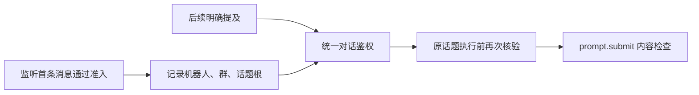

# 监听话题中的明确提及续聊

监听器已获配置者授权处理首条消息，但后续同话题的真人和机器人明确提及仍会重新申请对话授权。记录监听实际创建的话题来源，让同一接收机器人、群和话题内的明确提及继承该话题的对话许可。管理命令继续使用原有权限。

## 范围与边界

- 仅真实群话题回复生效，引用消息、其他话题、其他机器人、私聊和未明确提及不继承。
- 保留黑名单、管理命令鉴权及 prompt.submit 检查；不写入用户或群的永久授权名单。
- 监听被禁用后不再继承；来源记录跨进程重启保留，历史无来源记录的话题不推断授权。
- 作用于飞书普通对话公共入口，与 CLI、操作系统及 PTY/Tmux 后端无关；不改变 workflow、会中事件及其他 IM 的准入。

## 文件

- `src/services/message-listener-topic-access.ts`：准确的话题来源与回复上下文。
- `src/im/lark/event-dispatcher.ts`：真人和机器人共用的对话权限与话题路由。
- `src/daemon.ts`：监听来源落盘、执行前复查。
- `test/`：来源隔离、入口路由、执行检查和权限回归。

## 验收

证明监听话题内未单独授权的人和机器人在明确提及后均可继续；同时证明跨范围、黑名单、无提及、停用监听和管理命令不获得额外权限。运行相关测试与完整构建，提交 PR；现场版本与验证结果单独记录。

## 验证进展

- 11 个相关测试文件、595 个用例通过，包含真人/机器人入口、原话题路由、执行前复查、内容 hook、黑名单、停用监听、跨范围与访客 owner 隔离。
- 完整构建通过（含源代码、脚本和测试 mock 类型检查及资源审计）。
- 未做真实陌生人/外部机器人的飞书 E2E；需要上线后在新监听话题验证。
